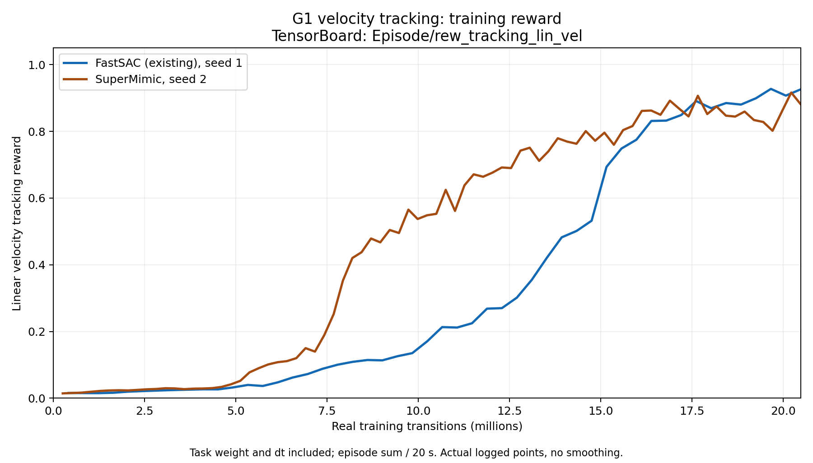
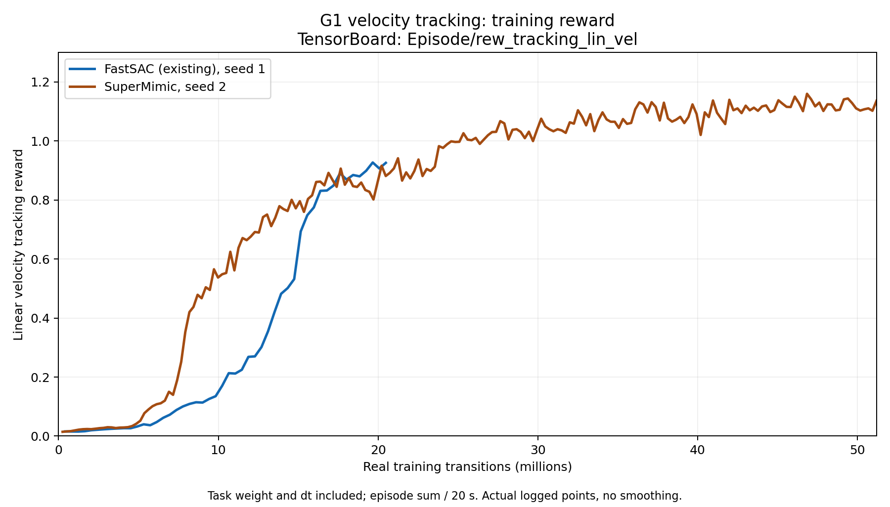

# SuperMimic: Isaac Gym G1 experiment

This branch packages the velocity-only SuperMimic adaptation on Holosoma
`9c238cf80f531c0e65d818348c3c1a5cc2764f5b`, using Isaac Gym Preview 4.
The G1 observations, actions, rewards, terrain, disturbances, randomization,
curriculum and termination rules are inherited from the released FastSAC task.
The entry point is `scripts/train_supermimic_isaacgym.py`; it imports this checkout.
No new task preset or simulator configuration is required.

The implementation follows HybridRobotics/SuperMimic commit
`5efbf114e11f725c31d83e217be987c13c0e4ce2`: generalized-coordinate dynamics,
physical prediction losses, running normalization, Muon/Adam partitioning,
8-step model fitting, 32-step differentiable policy rollouts and critic fitting.
This is a cold-start velocity adaptation, not the paper's motion-pretrained policy.
Third-party notices are in
`src/holosoma/holosoma/agents/supermimic/THIRD_PARTY_LICENSES.txt`.

## Runtime and training

Use Linux with Isaac Gym Preview 4 and a compatible NVIDIA driver. The measured
runtime used Python 3.8.20 and PyTorch 2.4.1+cu121. The upstream
`scripts/setup_isaacgym.sh` / `scripts/source_isaacgym_setup.sh` provide the legacy
setup workflow; they are not a fully pinned dependency lock. Activate the
working environment first, put its `bin` directory on `PATH` (including Ninja),
and run from this repository root. Keep Isaac Gym imported before PyTorch.

The selected configuration is `configs/supermimic/isaacgym_g1.json`: WM width
1024, 10 model updates, FIFO 1000, actor batch 4096 and update/data ratio 0.4.
Default training uses 4096 environments. 5000 learner iterations collect
51.2 million real transitions; iteration 2000 corresponds to 20.48 million.

To prepare the seed-1 validation pilot before the fresh seed-2 comparison:

```bash
python scripts/train_supermimic_isaacgym.py \
  --base-dir logs/supermimic-pilot --seed 1 --iterations 1000
```

Checkpoints and production actor-seed snapshots are required for full update
validation. Retain their adjacent configuration and TensorBoard files outside Git.
An optional `--algorithm-config FILE` changes algorithm settings only.

## Verification

```bash
PYTHONPATH="$PWD/src/holosoma" python -m pytest scripts/tests/test_supermimic_protocol.py \
  src/holosoma/holosoma/agents/supermimic/tests -q

python scripts/check_supermimic_reference.py \
  --official-source /path/to/pinned/supermimic \
  --muon-source /path/to/torch/optim/_muon.py \
  --normalization-source /path/to/rsl_rl/modules/normalizer.py

python scripts/validate_supermimic_complete.py \
  --checkpoint /path/to/model_1000.pt --output logs/complete-validation
```

The reference check extracts numerical functions from external source files;
`configs/supermimic/reference_sources.json` records the exact audited SHA-256
values. It requires the PyTorch 2.10 Muon source and the audited RSL normalization
source in addition to the pinned official repository. These sources are not
vendored. A mismatched file fails explicitly.

Complete validation checks physical/reward consistency, finite differences of
the full imagined objective, critic calibration and the actual optimizer update
in three fresh simulator seeds. Passing requires the production actor batch and
a filled FIFO snapshot. Small smoke runs cannot authorize a benchmark.

Packaging removes unused simulator adapters and extracts shared validation
helpers, so source hashes differ from the original working directory. Old
validation manifests and actor-seed snapshots must not be relabeled as new ones:
the gates intentionally require matching source hashes. The included images
remain results from the original completed experiment, not a new training run.

## Reuse the existing FastSAC baseline

```bash
python scripts/compare_supermimic_existing_fastsac.py \
  --validation logs/complete-validation/validation.json \
  --fastsac-checkpoint /path/to/existing/fastsac/model_0005000.pt \
  --output logs/comparison --seed 2 --samples 51200000

python scripts/plot_linear_velocity_reward.py \
  --comparison logs/comparison --output logs/comparison/figures
```

The comparison runner trains only SuperMimic, preserves its live training state
during intermediate evaluations, and checks the baseline task configuration.
FastSAC's step-zero batch is counted: the existing endpoint has 20,484,096
transitions versus SuperMimic's 20,480,000. The 51.2M endpoint is a separate,
larger-budget result. One training seed per method does not estimate variation
across training seeds. Additional simulator evaluation seeds are not training
replicates. The saved `Episode/rew_tracking_lin_vel` curve includes reward weight
and control dt, with episode sums divided by the fixed 20-second horizon.

## Result images

Only the two English-language result images are included. No reports, raw logs,
checkpoints or generated data are committed.




